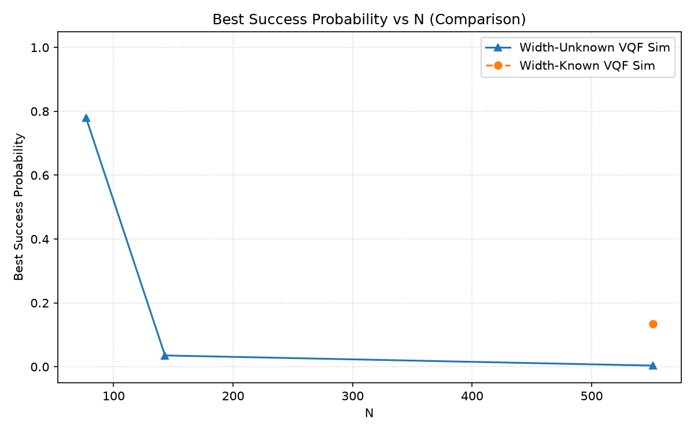
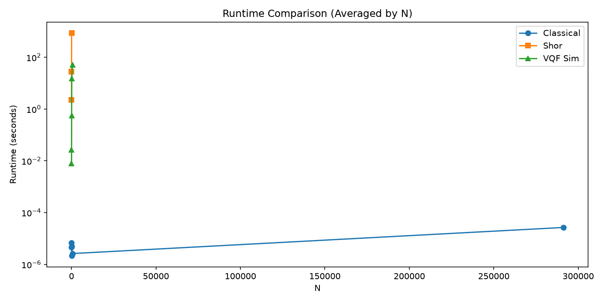
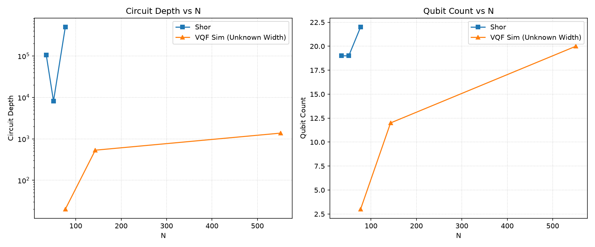
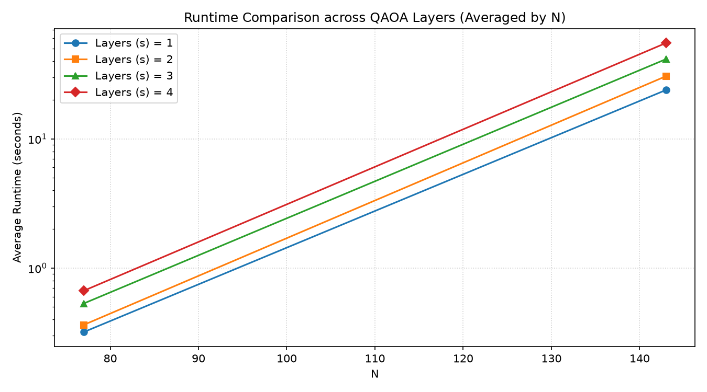
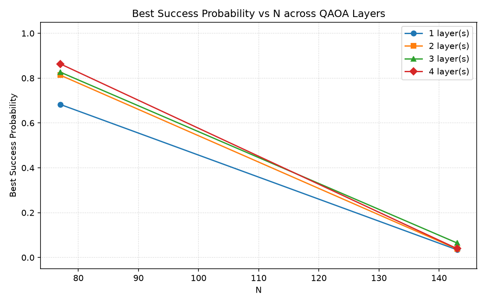

# Width-Agnostic VQF

Current implementations of VQF assume the bit-lengths of the factors the N. This is hardly applicable in real world, where RSA public keys are not distributed along with the factor bit-lengths. We have implemented a width-agnostic VQF algorithm, benchmarked on 6 odd, square-free bi-primes and compared with custom implementations of trial-division (classical) and Shor's simulation, all using the  Qiskit's quantum simulation framework.

## What is in here
- `src/classical.py`: trial division
- `src/shor.py`: Shor's algorithm
- `src/vqf_preprocessing.py`, `vqf_qubo.py`, `vqf_hamiltonian.py`, `vqf_sim.py`: VQF pipeline
- `src/config.py`: experiment configuration and result format; `src/utils.py`: utility functions; `src/plots.py`: plot functions
- `comparative_study.ipynb`: runs everything and produces the figures
- `results/`: JSON outputs; `figures/`: saved plots

## VQF pipeline
1. Binary long multiplication gives one equation per bit of N (Burges).
2. Classical preprocessing fixes or substitutes variables (Anschuetz Eq. 5; Karamlou et al.,
   App. C). Factor bit-lengths are not assumed known; only upper bounds derived from N are used.
3. Squared clauses give the cost function; Schaller-Schützhold penalty lowers the degree of qubit interaction
   where possible.
4. Bits map to Pauli-Z operators, giving the Ising Hamiltonian.
5. QAOA with p layers; COBYLA minimizes the Ising Hamiltonian, with Zhou et al. INTERP initialization.
6. Sampled bitstrings are decoded and checked.

## Setup
Note: This project was done solely with a research perspective and is only intended for academic research purposes.

```
git clone https://github.com/Gayathri260/width-agnostic-vqf
cd quantum-factoring-comparative-study
pip install -r requirements.txt
jupyter notebook comparative_study.ipynb
```

Tested with Qiskit 2.4.2, Qiskit Aer 0.17.2, Python 3.14.7.

## Results

All runs use the width-agnostic encoding (factor bit-lengths unknown), statevector simulation on
Qiskit Aer, 2 QAOA layers, 4096 shots, COBYLA (max 500 iterations), 3 random starts for the
first layer, and transpiler optimization level 1. Success probability is the fraction of shots
that decode to the correct factors. Values are means over 2 runs.

### Width-agnostic VQF

| N | Qubits after preprocessing | Circuit depth | Gate count | Mean success | Best success |
|---|---|---|---|---|---|
| 35 | 0 (solved by preprocessing) | – | – | – | – |
| 51 | 0 (solved by preprocessing) | – | – | – | – |
| 77 | 3 | 20 | 31 | 0.6956 | 0.7793 |
| 143 | 12 | 532 | 815 | 0.0309 | 0.0354 |
| 551 | 20 | 1373 | 2471 | 0.0034 | 0.0037 |
| 291311 | 61 | – | – | not simulated | not simulated |

291311 needs 61 qubits after preprocessing, which is not feasible to simulate.

### Cost of not assuming the factor bit-lengths

| N | Qubits, width-unknown | Qubits, width-known |
|---|---|---|
| 77 | 3 | 0 |
| 143 | 12 | 1 |
| 551 | 20 | 12 (depth 258, 465 gates, mean success 0.1320) |

### Observations
- Small N works well: 35 and 51 are solved by preprocessing; 77 reaches 0.78 success with 3 qubits
- The cost of realism is steep: qubits and depth grow quickly, and 291311 needs 61 qubits
- At 2 layers, success probability falls from about 0.70 (77) to 0.03 (143) and 0.003 (551).
- In the layer sweep, smaller instances improve with more layers. For larger instances, success
  stays equally low at every depth.
- Shor's circuit depth and qubit count grow much faster than VQF's (see `figures/circuit_metrics.png`). Trial division is fastest at every N tested (see `figures/runtime_comparison.png`).

### Figures






## References
- Burges, Factoring as Optimization, (2002); https://www.microsoft.com/en-us/research/publication/factoring-as-optimization/
- Anschuetz et al., Variational Quantum Factoring, QTOP 2019 (Springer); arXiv:1808.08927
- Karamlou et al., npj Quantum Inf. 7, 156 (2021); arXiv:2012.07825
- Schaller & Schützhold, arXiv:0708.1882
- Hatwar, Aggarwal, Bhowmik, COMSNETS 2025; doi:10.1109/COMSNETS63942.2025.10885675
- Xu et al., Phys. Rev. Lett. 108, 130501 (2012)
- Zhou et al., Phys. Rev. X 10, 021067 (2020)
- Farhi, Goldstone, Gutmann, arXiv:1411.4028
- Shor, Proc. FOCS 1994

## License
MIT
